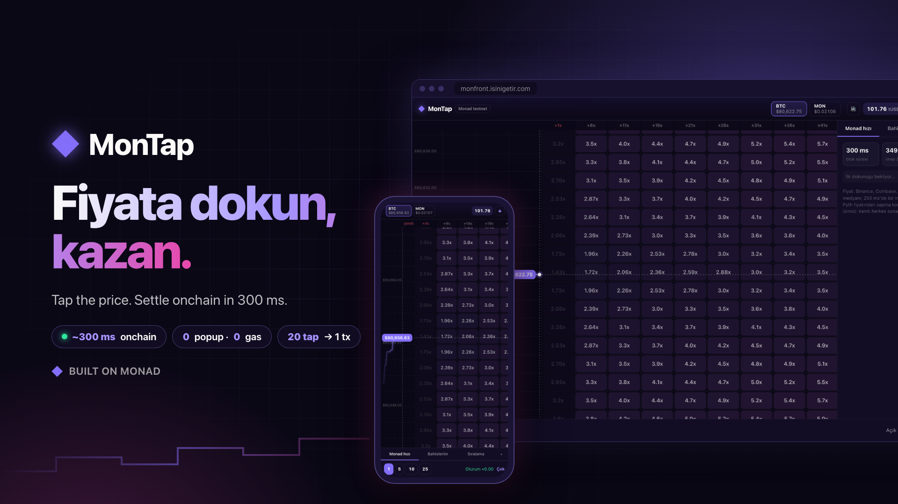

# MonTap

**Tap-trading on Monad.** A live price chart with a grid of price bands × 5-second time windows. Tap a cell: if the price enters that band during that window, your stake is paid back × the cell's multiplier. Every tap is an onchain Monad transaction, confirmed in ~300 ms, with no wallet popups and no gas for the player.



- **Live app:** https://monfront.isinigetir.com
- **API:** https://monback.isinigetir.com · WebSocket `wss://monback.isinigetir.com/ws`
- **Network:** Monad testnet (chain ID `10143`)

| Measured | Value |
|---|---|
| Tx confirmation (relayer → receipt) | p50 ~330 ms, best 149 ms |
| Batching | 20 taps → 1 transaction, confirmed in 155 ms |
| Onboarding | ~2 s, 0 popups, 0 gas |
| Price feed | median of 5 exchanges, signed every 250 ms |

---

## How it works

```
Browser (Next.js)                         Backend (Node / TypeScript)                  Monad
─────────────────                         ───────────────────────────                  ─────
canvas grid, 60 fps          tap ───────► Relayer  ─ batches taps (≤500 ms / 20) ──►  TapMarket.placeBets
session key signs each tap                         ─ gasless session / deposit / withdraw
                                          Oracle   ─ Binance, Coinbase, OKX, Bybit,
sees wins instantly  ◄── signed ticks ──             Kraken → USD median → EIP-712 sig
from the tick stream     (WebSocket)      Keeper   ─ every 1 s: resolve(wins, losses) ──►  TapMarket.resolve
                                          Indexer  ─ events → Postgres → WebSocket ◄──     events
                                                                                          HouseVault (LP)
                                                                                          Pyth (deviation check)
```

1. **Onboarding.** "Play now" creates a browser wallet; alternatively the player connects an injected wallet such as MetaMask. The backend mints test USDC from the faucet. The player signs an EIP-2612 permit, which the relayer uses to deposit into the game balance gaslessly. The player then signs one EIP-712 `SessionGrant` that authorizes a browser-held session key with a spend limit and an expiry.
2. **Tap.** The session key signs an EIP-712 `Tap` (cell, stake, minimum multiplier, nonce, deadline). The relayer pre-validates it, batches it with other taps, and submits one `placeBets` transaction together with a fresh signed price tick.
3. **Pricing onchain.** `TapMarket` verifies the price tick, then computes the multiplier from the onchain table: `distance from the current band × windows ahead`. It reserves the worst-case payout in the `HouseVault`.
4. **Win detection.** The frontend checks every incoming tick against open bets and shows a win the moment the price touches the cell.
5. **Settlement.** The keeper calls `resolve()` once per second. Wins are proven with the signed tick that touched the band. Bets past `windowEnd + grace` are closed as losses. Settlement is permissionless: anyone holding a valid tick can submit it.

### Grid math

```
band   = floor(price / bandSize)        // [band·size, (band+1)·size)   BTC: $2,  MON: $0.000004
window = floor(unixSeconds / 5)         // [w·5, (w+1)·5) s
dist   = |band − currentBand|           // 0..15
col    = window − currentWindow         // 0..11, window start must be ≥ now + minLead
mult   = multipliers[feed][dist][col]   // basis points, 0 = cell disabled
```

A bet wins if **any** signed tick with `timestampMs ∈ [windowStart, windowEnd)` has a price inside the band.

---

## Repository layout

```
contracts/   Solidity (Foundry): TapMarket, HouseVault, MockUSDC, tests, deploy scripts, pricing tools
backend/     TypeScript: oracle, relayer, keeper, indexer, REST + WebSocket API
frontend/    Next.js 15 game client
shared/      exported ABIs + deployment addresses
deploy/      nginx site configs + deploy script
docs/        API reference, design notes, media
docker-compose.yml
```

---

## Contracts (`contracts/`)

Solidity `0.8.31`, `evm_version = osaka`, Foundry with `network = "monad"`, so gas is measured with Monad's MIP-8 storage pricing. Built on OpenZeppelin v5.

### `TapMarket.sol` — bet engine

| Function | Purpose |
|---|---|
| `deposit`, `depositWithPermit` | Fund the game balance. The permit path lets the relayer deposit gaslessly. |
| `withdraw`, `withdrawBySig` | Withdraw. The signature path is gasless, signed by the main wallet. |
| `setSession`, `registerSession`, `revokeSession` | Session key with spend limit and expiry. `registerSession` takes an EIP-712 `SessionGrant`. |
| `placeBets(tick, tickSig, taps[], sigs[])` | Permissionless batch of session-signed taps. An invalid tap emits `TapRejected` instead of reverting the batch. |
| `placeBetsDirect(tick, tickSig, taps[])` | Play without the relayer (`tap.user == msg.sender`). |
| `settleWins(tick, sig, betIds[])` | Permissionless win proof for one tick. |
| `expire(betIds[])` | Close bets past `windowEnd + grace` as losses. |
| `resolve(proofs[], expired[])` | Keeper path: wins proven by different ticks plus losses, in one transaction with one vault transfer. |
| `setFeed`, `setMultipliers`, `setLimits`, `setTiming`, `setOracle`, `setPythMaxAge`, `pause` | Owner configuration. Band sizes and multiplier tables can change without a redeploy. |

Design notes:
- **Price ticks:** `PriceTick(feedIdx, price, timestampMs)` is EIP-712-signed by an allow-listed oracle key. Each tick is checked against the onchain **Pyth** price for the same feed: it is rejected if it deviates by more than `maxDevBps` (BTC 1%, MON 2%), unless the Pyth price is older than `pythMaxAge`.
- **Late-bet protection:** a window must start at least `minLead` seconds after inclusion, and a winning tick must come after the bet's placement second.
- **Replay protection:** bitmap nonces per user, with deadlines and a per-session spend cap. Taps carry `minMultBps` so the relayer cannot fill them at a worse multiplier.
- **Storage layout tuned for Monad (MIP-8):**
  - Bets live in a packed `Bet[]` array, 2 slots each, so consecutive bets share 128-slot pages.
  - Per-cell and per-window exposure caps live in ring buffers instead of fresh mapping slots.
  - Vault capacity is read with a single call.
- **Payouts:** always sent to `bet.user`, never to `msg.sender`.

### `HouseVault.sol` — LP vault (ERC-4626)

- **Share pricing:** `totalAssets = balance − reserved`. Open bets are priced at their worst case the moment they are placed, so an LP cannot exit before a known loss or enter after one.
- **Exposure limits:** reservations are capped by `maxUtilizationBps` (50%). On top of that, the market enforces per-bet, per-cell and per-window caps.
- **LP restrictions:** shares are non-transferable and deposits are self-only. A 120 s cooldown applies to withdrawals. Virtual-share offset protects against inflation attacks.

### `MockUSDC.sol`

Test USDC with 6 decimals and EIP-2612 permit. Anyone can mint up to 1,000 per call, so judges and players don't need a faucet.

### Multipliers

`tools/gen_multipliers.py` runs a Monte Carlo of GBM sampled every 250 ms with a 5% house edge.
- **Robustness:** the table is priced across a *range* of volatilities, and each cell keeps the lowest multiplier. Center cells are protected in calm markets, far cells in volatile ones.
- **Backtest:** `tools/backtest.py` replays the oracle's real tick archive and reports each cell's expected value. All cells have EV < 1.

### Tests

```sh
cd contracts
git submodule update --init --recursive
(cd lib/pyth && npm ci)                       # Pyth SDK (npm package)
forge test                                    # 35 unit tests + invariant suite
forge test --match-contract GasTest -vv       # gas under Monad pricing
```

- **Unit tests** cover:
  - signatures, nonces and spend limits
  - late windows, stale, future or unknown-signer ticks, and Pyth deviation
  - millisecond window bounds, `resolve` batching and ring-buffer resets
  - vault cooldown and transferability
- **Invariant tests** (8k random calls) assert three properties:
  - the vault is always solvent;
  - `reserved` equals the sum of open-bet payouts;
  - the market's USDC equals the users' ledger.

Measured gas: 1-tap batch ~385k, 20-tap batch ~1.98M, `resolve` (2 wins + 1 loss) ~213k.

### Deploy

```sh
source ../keys.env   # DEPLOYER_PRIVATE_KEY, ORACLE_ADDRESS (not committed)
PYTH_ADDRESS=0xFC6bd9F9f0c6481c6Af3A7Eb46b296A5B85ed379 ORACLE_ADDRESS=$ORACLE_ADDRESS \
USDC_ADDRESS=<optional; empty deploys MockUSDC> \
forge script script/Deploy.s.sol --rpc-url monad_testnet --broadcast --slow \
  --private-key $DEPLOYER_PRIVATE_KEY --gas-estimate-multiplier 110

# change band sizes / multiplier tables (run with no open bets)
MARKET=<address> forge script script/Configure.s.sol --rpc-url monad_testnet --broadcast --private-key $DEPLOYER_PRIVATE_KEY
```

Verification works through Sourcify on MonadVision (`--verifier sourcify --verifier-url https://sourcify-api-monad.blockvision.org/`).

### Deployed (Monad testnet, verified)

| Contract | Address |
|---|---|
| TapMarket | [`0x644cAEb542644E4AE5F277aD61C3C6249288305A`](https://testnet.monadvision.com/address/0x644cAEb542644E4AE5F277aD61C3C6249288305A) |
| HouseVault | [`0x19861DE5204855d80B14336E209B1930AC8a14aE`](https://testnet.monadvision.com/address/0x19861DE5204855d80B14336E209B1930AC8a14aE) |
| MockUSDC (tUSDC) | [`0xBE2f84712EFBcB54DA566AC44e6e6Bd1b42e7b41`](https://testnet.monadvision.com/address/0xBE2f84712EFBcB54DA566AC44e6e6Bd1b42e7b41) |
| Pyth (deviation reference) | `0xFC6bd9F9f0c6481c6Af3A7Eb46b296A5B85ed379` |

---

## Backend (`backend/`)

Node 22, TypeScript, Fastify, viem, Postgres (`pg`), Redis (`ioredis`). Two processes:

- `dist/server.js` runs the oracle, relayer, indexer and API.
- `dist/keeper.js` runs the keeper, with its own key.

| Module | What it does |
|---|---|
| `oracle/sources.ts` | WebSocket clients for Binance, Coinbase, OKX, Bybit and Kraken, with best bid/ask mids. Each source auto-reconnects and has a liveness watchdog. |
| `oracle/oracle.ts` | Converts USDT pairs to USD using a live USDT/USD rate, takes the median and requires at least 3 sources for BTC and 2 for MON. It signs a `PriceTick` every 250 ms, publishes it to Redis and WebSocket, and keeps 10 minutes of signed ticks plus a price-change archive for calibration. |
| `relayer/sender.ts` | Per-key transaction lanes with local nonce management, because Monad has no public mempool. Uses `eth_sendRawTransactionSync` for ~300 ms receipts and `eth_estimateGas × 1.1` limits, since Monad bills the gas limit. An hourly MON budget guards against spam. |
| `relayer/taps.ts` | Off-chain pre-checks (signature, session, window, stake), so invalid taps never cost gas. Batches up to 20 taps or 500 ms into one `placeBets`, then maps `BetPlaced` / `TapRejected` logs back to each request. |
| `relayer/actions.ts` | Gasless `registerSession`, `depositWithPermit`, `withdrawBySig`, plus a test USDC faucet with per-address cooldown. |
| `keeper/keeper.ts` | Tracks open bets and matches every tick against them. Once per second it sends one `resolve()` with all wins and expirations. Before expiring a bet, it re-checks the tick history so a missed touch is still paid. |
| `indexer.ts` | Polls `TapMarket` logs in ≤100-block ranges into Postgres, idempotently, and publishes them to Redis / WebSocket. |
| `api/server.ts` | REST + WebSocket API with rate limits. All chain reads the client needs, including permit, session and withdraw nonces, come back in one multicall, so the browser never calls the RPC. |

### API

| Method | Path | |
|---|---|---|
| GET | `/health` | oracle sources, tick age, relayer spend this hour |
| GET | `/config` | chain, contracts, timing, stake limits, feeds (band size + 16×12 multiplier table) |
| GET | `/ticks/:feed?limit=` | recent signed ticks |
| GET | `/me/:addr` | game balance, wallet tUSDC, session, nonces, stats, last 50 bets |
| GET | `/bets/recent`, `/leaderboard`, `/stats` | global feed, 24 h PnL ranking, totals + tx latency p50/p90 |
| POST | `/faucet` `{user}` | mint 100 tUSDC to the wallet |
| POST | `/deposit` `{user, amount, deadline, v, r, s}` | permit deposit |
| POST | `/session` `{user, sessionKey, spendLimit, expiry, sig}` | register session key |
| POST | `/tap` `{tap, sig}` | → `{status:"placed", betId, multBps, tx, latencyMs}` or `{status:"rejected", reason}` |
| POST | `/withdraw` `{user, to, amount, deadline, sig}` | gasless withdrawal |

WebSocket: send `{"op":"sub","ch":["tick:0","tick:1","txs","chain:events","user:0x…"]}`. Full reference: [`docs/API.md`](docs/API.md).

### Configuration

Copy `.env.example` to `.env`.

| Variable | |
|---|---|
| `DATABASE_URL`, `REDIS_URL` | Postgres / Redis (set by docker-compose) |
| `MONAD_CHAIN_ID`, `MONAD_RPC_URL` | network |
| `TAP_MARKET_ADDRESS`, `HOUSE_VAULT_ADDRESS`, `USDC_ADDRESS`, `START_BLOCK` | deployment |
| `ORACLE_PRIVATE_KEY` | tick signer (no MON needed) |
| `RELAYER_PRIVATE_KEYS` | comma-separated relayer keys (funded with MON) |
| `KEEPER_PRIVATE_KEY` | keeper key (funded with MON) |
| `CORS_ORIGIN` | allowed frontend origins |
| `TICK_INTERVAL_MS`, `MAX_TAPS_PER_TX`, `TAPS_PER_MIN` | oracle cadence, batch size, per-user tap rate |
| `FAUCET_AMOUNT`, `FAUCET_COOLDOWN_SEC`, `RELAYER_HOURLY_BUDGET_MON` | faucet and spam limits |

```sh
cd backend
npm ci
npm run abi          # regenerate src/abi/*.ts from shared/abi
npm run dev          # server; `npm run dev:keeper` for the keeper
npm run build

# against a running deployment
API=https://monback.isinigetir.com npx tsx scripts/e2e.ts    # wallet → faucet → deposit → session → 6 taps → results
API=https://monback.isinigetir.com npx tsx scripts/load.ts   # concurrent users, reports taps per tx and latency
```

---

## Frontend (`frontend/`)

Next.js 15 (App Router, standalone output), React 19, zustand, viem. Styled with plain CSS.

| File | |
|---|---|
| `components/GameCanvas.tsx` | Single Canvas 2D renderer outside React's render loop, at 60 fps. It draws a scrolling price line, the multiplier grid, bet states (pending / placed / won / lost) and a win animation. Tap hit-testing maps the pointer to `(band, window)`. |
| `lib/game.ts` | Game state: price series, local bets, optimistic win detection from ticks, server-clock offset estimation, onboarding flow, tap submission. |
| `lib/wallet.ts` | Browser ("Play now") or injected wallet. Handles the session key in localStorage, EIP-712 signing of `Tap`, `SessionGrant`, `Withdraw` and `Permit`, and gasless deposit / withdraw. |
| `lib/api.ts` | REST client plus a reconnecting WebSocket with channel subscriptions. |
| `components/Ui.tsx` | Top bar (feeds, balance, top-up), onboarding, stake selector, session PnL, cash-out, and the "Monad speed" panel with a live tx feed and explorer links. Also "My bets" and "Leaderboard". |
| `app/globals.css` | Dark theme; on mobile the side panel becomes a collapsible bottom drawer. |

```sh
cd frontend
npm ci
NEXT_PUBLIC_API_URL=https://monback.isinigetir.com npm run dev
```

---

## Running the full stack

```sh
cp .env.example .env            # fill keys and addresses
docker compose up -d --build    # frontend :4200, backend :4201, keeper, postgres, redis (bound to 127.0.0.1)
```

`deploy/nginx/` holds the reverse-proxy configs, including the `/ws` WebSocket upgrade, with TLS from Let's Encrypt. `deploy/deploy.sh` rsyncs the project and runs `docker compose up -d --build` on the server. It never sends `.env`, `keys.env` or Foundry caches.

---

## Trust model

- **Bets and payouts are onchain.** Multipliers are computed in the contract from a signed price. Payouts go only to the bettor.
- **The relayer cannot forge or alter taps.** Each tap is signed by the player's session key, carries a nonce and has a minimum-multiplier guard. `placeBetsDirect` bypasses the relayer entirely.
- **Settlement is permissionless.** Any valid signed tick inside a window proves a win, and anyone can submit it.
- **The oracle signer is operated by MonTap.** Every tick is checked onchain against Pyth with a deviation bound, and every signed tick is published over the API/WebSocket, so it can be audited.
- **The vault reserves worst-case payouts up front.** Exposure is capped per bet, per cell, per window and overall.

More: [`docs/API.md`](docs/API.md) · [`docs/monad-dev-research.md`](docs/monad-dev-research.md) · [`docs/media/`](docs/media/)
